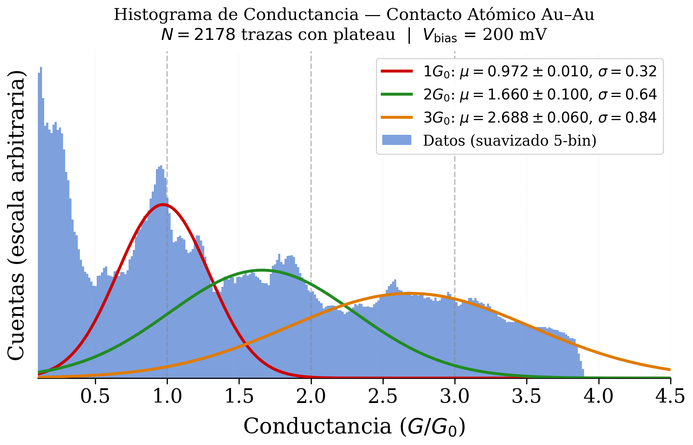
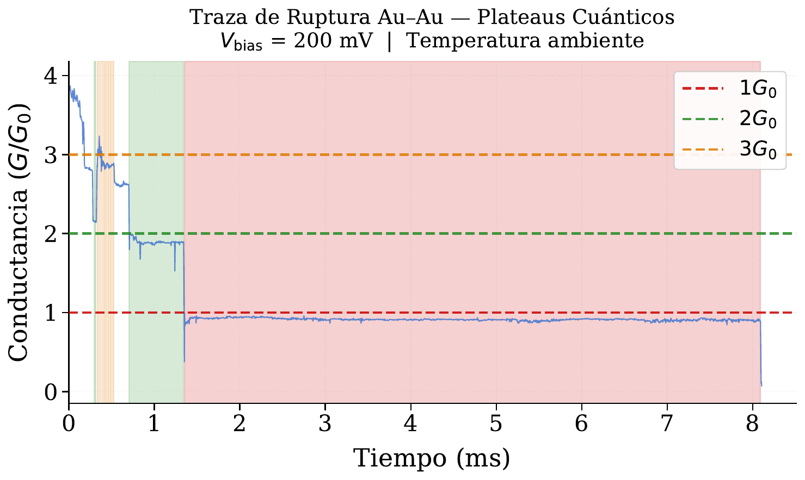
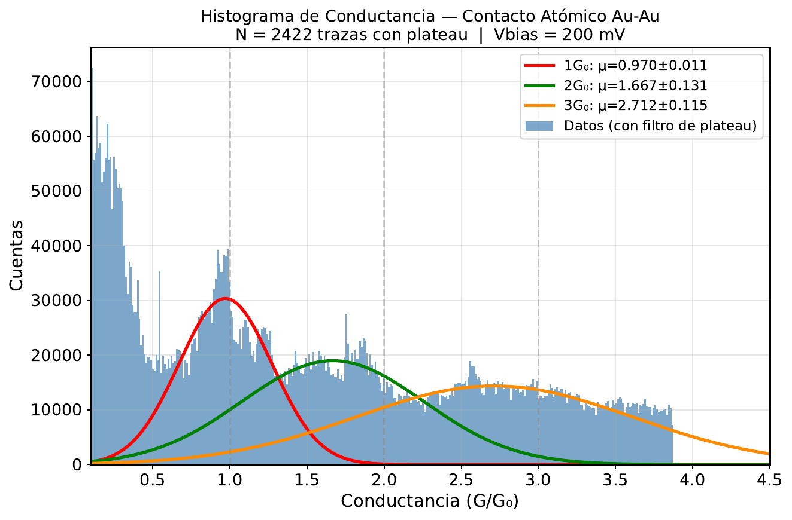

# Quantum Conductance in Gold Atomic Contacts (MCBJ)

Measurement and analysis of **conductance quantization** in gold atomic-scale contacts using a low-cost **Mechanically Controlled Break Junction (MCBJ)** at room temperature.

**Credits.** The MCBJ device and its read-out electronics (bias source and transimpedance amplifier) were designed and built by **David Llerena** and **Ernesto Medina** (USFQ).
The 2,423 breaking traces in `data/raw/` were acquired by us with that setup, and the analysis pipeline in `src/` is our own work.

**Authors:** Yahashua Paredes, Ezequiel Guerrero — Experimental Physics, Universidad San Francisco de Quito (USFQ)
**Presented at:** USFQ Experimental Physics Poster Session, 2026 — [poster (PDF)](poster/poster.pdf)



## Key result

| Peak | Fitted center $\mu \pm \sigma_\mu$ ($G_0$) | Deviation from $nG_0$ |
|---|---|---|
| $1G_0$ (monomer) | **0.972 ± 0.010** | −2.8 % |
| $2G_0$ | 1.660 ± 0.100 | −17 % |
| $3G_0$ | 2.688 ± 0.060 | −10 % |

The single-atom peak gives a transmission $T_1 = 0.972 \pm 0.010$, consistent with ballistic single-channel transport in Au and with low-temperature measurements ($0.97 \pm 0.15$ at 4.2 K, Sabater *et al.*, *Phys. Rev. B* **88**, 205416, 2013).

## Physics

When a metallic contact is thinned down to a single atom, electrons cross it ballistically and the conductance is quantized (Landauer–Büttiker):

$$G = G_0 \sum_{n} T_n, \qquad G_0 = \frac{2e^2}{h} \approx 77.48\ \mu\text{S}$$

For Au (one 6s channel) we expect $T_1 \approx 1$: plateaus near $1G_0$ for monomers and near integer multiples for larger contacts.



## Setup *(built by D. Llerena and E. Medina)*

- Au wire, Ø 0.1 mm, 99.99 % purity, on a 3D-printed PLA substrate (three-point bending)
- Piezo actuator Thorlabs PK3JMAP1 + KPZ101 controller
- Constant bias $V_\text{bias} = 200$ mV (LM7805), transimpedance amplifier (TL084, $R_f = 100\ \text{k}\Omega$)
- DAQ Digilent 1208HS, $\Delta t = 2\ \mu$s

$$\frac{G}{G_0} = \frac{V_\text{out}}{V_\text{bias}\, R_f\, G_0} = \frac{V_\text{out}}{1.55\ \text{V}}$$

## Analysis pipeline

1. **Acquisition** — one file per breaking event, ~4,300–5,000 samples each.
2. **Plateau filter (2 stages)**
   - Stage A: discard monotonic traces with $f^+ < 0.30$
   - Stage B: require $\sigma_\text{local} < 0.06\,G_0$ over ≥ 6 consecutive windows centered at $nG_0$
3. **Histogram** — 300 bins in $[0.1, 4.5]\,G_0$, 5-bin uniform smoothing
4. **Gaussian fits** — Levenberg–Marquardt, window $|G - nG_0| \le 0.40\,G_0$

| | Traces | % |
|---|---|---|
| Acquired | 2,423 | 100 |
| Accepted | 2,178 | 89.9 |
| Rejected — monotonic ($f^+ < 0.30$) | 12 | 0.5 |
| Rejected — no plateau near $nG_0$ | 233 | 9.6 |



## Data

`data/raw/` holds the 2,423 breaking traces, one file per trace (`<n>Au_200mV_5Amp_*.txt`).
Each file is a single column of DAQ output voltage $V_\text{out}$ in volts, **comma as decimal separator**, sampled every $2\ \mu$s.

```python
import numpy as np
v = np.loadtxt("data/raw/0Au_200mV_5Amp_.txt", converters={0: lambda s: float(s.replace(",", "."))})
g = v / 1.55   # conductance in units of G0
```

## Repository structure

```
data/raw/    2,423 raw breaking traces
src/         procesar_datos.py (filter, histogram, fits), buscar_mejor_traza.py (trace ranking)
figures/     figures used in the poster
poster/      A0 poster (PDF)
```

## How to run

```bash
pip install -r requirements.txt
cd src
python procesar_datos.py      # filter, histogram, Gaussian fits -> figures/figura_histograma_poster.*
python buscar_mejor_traza.py  # ranks traces with 1, 2 and 3 G0 plateaus -> figures/mejor_traza_rank*.*
```

Running `procesar_datos.py` on `data/raw/` reproduces the numbers above: 2,178 / 2,423 traces accepted and
$\mu_{1G_0} = 0.9721 \pm 0.0097$, $\mu_{2G_0} = 1.660 \pm 0.100$, $\mu_{3G_0} = 2.688 \pm 0.060$.

## Limitations and next steps

- The $2G_0$ and $3G_0$ peaks are broader and shifted: multi-atom contacts are less stable at room temperature. Confirming them needs $N \gtrsim 10{,}000$ traces and measurements at 4.2 K.
- The −2.8 % shift of the $1G_0$ peak is attributed to surface contaminants at room temperature.

## References

- M. Sabater *et al.*, *Phys. Rev. B* **88**, 205416 (2013)
- Borja *et al.* (2020)
